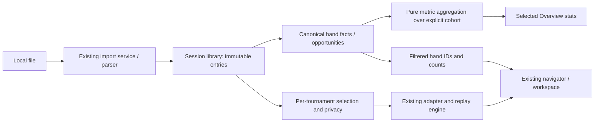

# Phase 1C: Tournament Library, Deterministic Hand Navigation and Tournament Stats

Status: DESIGN APPROVED on 2026-11-07, including the visual implementation constraints below. Writing executable implementation plans is authorized; production implementation is not authorized yet. Prepared from the current working tree and the user's detailed Phase 1C brief.

## 1. Intent, authority and boundaries

Let someone retain multiple GG tournaments during a session, find hands worth revisiting through factual filters, and see how Hero actually played through auditable counts and opportunities. No strategic assessment is involved.

The user explicitly accepts Phase 0, Phase 1A, Phase 1B, Phase 1B.1 and the finalized PlayingCard system as complete/approved. Their existing designs, source semantics and visual protection remain authoritative. Phase 1 as a whole remains IN PROGRESS. Some repository status prose predates this acceptance; it is history, not a reason to reopen completed work.

Phase 1C is frontend session memory only. No database, backend, localStorage/sessionStorage for imports, accounts, AI, solver, grades, recommendations, leaks, targets, comparison populations, lifetime Development UI, or tournament report generation. No parser, financial ledger, replay engine, card artwork or seat-layout rewrite. Existing development-only visual-preview storage is unrelated and supplies no justification for persisting tournaments.

The user's two subsequent decisions are approved requirements:

- Use one session library above the existing workspace and a pure reusable facts/metrics layer. Do not add a central application-wide store without a demonstrated necessity.
- Recognize exact duplicates without another entry. Reject different contents under an existing tournament ID and preserve the existing entry unchanged. No automatic replacement or merge. Partial-export/multi-file merging requires a future design covering overlaps, order, metadata conflicts and incomplete exports.

The full design gate is approved, subject to the following user-supplied visual constraints. Earlier recommendation wording below records design rationale; it no longer signifies a pending design decision.

### Binding visual implementation clarification

The CURRENT implemented application is the visual source of truth for sidebar, branding, typography, page headings, navigation, spacing, buttons, the existing Tournament workspace and the Replayer/table/card system. The mockup approves Library/Stats structure and mobile behavior, not its serif-heavy surrounding shell or different sidebar treatment.

- Library rows remain metadata-first and restrained, using existing Study surfaces. Overview/Open Tournament is primary; Replayer and Review Queue are secondary shortcuts. No row statistics.
- Overview uses primary VPIP/PFR/3-Bet and secondary Saw Flop/source-confirmed WTSD/W$SD, neutral styling, numerator/denominator, definitions, Single-tournament sample context and W$SD masking.
- Filters are a compact `All | Played | Postflop | Showdown` row with counts inside the EXISTING hand navigator, above its existing list. Previous/Next hand controls remain compact and navigator-local. Preserve table, compact cards and geometry; the schematic is not a new Replayer layout.
- Never ship DESIGN PREVIEW banners, Phase 1C review footers, placeholder metrics, explanatory proposal boxes or schematic poker-table placeholders.
- Production copy stays concise. Detailed methodology belongs in Definition / Coverage controls, not permanent explanatory paragraphs.

## 2. Current-state findings

| Area               | Repository evidence                                                                                                                                                                   | Consequence                                                                                                     |
| ------------------ | ------------------------------------------------------------------------------------------------------------------------------------------------------------------------------------- | --------------------------------------------------------------------------------------------------------------- |
| Import ownership   | `src/ui/useTournamentImport.ts` holds one discriminated `ImportState`; `reading` replaces the ready tournament, cancellation becomes idle, and errors discard the visible ready state | Separate durable-in-session entries from the transient upload attempt. Preserve generation/unmount safeguards   |
| Import boundary    | `src/services/tournamentImport.ts` validates a local text file and calls `parseGgTournament`; failures are atomic                                                                     | Keep this service and parser behavior; a bad file cannot create a partial library entry                         |
| Routing            | `src/ui/App.tsx` owns local route and three-section tab state; URL query parameters initialize demo/QA views                                                                          | Add a library/selected-tournament view within the existing route. No routing package needed                     |
| Selected workspace | `ImportedTournamentWorkspace.tsx` consumes `ReadyImportState`, uses shared cards, and offers Overview, Replayer and Review Queue                                                      | Preserve workspace and replay props through an adapter selector; add Library return/context and a stats section |
| Navigator          | `ImportedHandNavigator.tsx` maps all hands to buttons, chronological `handNumber`, Hero cards and source ID. Review Queue uses the same component                                     | Filter IDs without reordering or renumbering source hands; keep Queue factual                                   |
| Replay privacy     | `useTournamentImport.ts`, `replay.ts`, `replayNavigation.test.ts` reset selected hands to cursor 0/result hidden; source SHOW events are individually timed, collection is clamped    | Keep those semantics. A navigation boundary is not a statistical showdown definition                            |
| Metadata           | `domain/handHistory.ts` exposes room, tournament ID/name, nullable exact buy-in/currency, source-local time range, game, tables, blind levels and hands                               | Library can show real metadata. No finish, prize, field size, entry/re-entry count or profitability is known    |
| Canonical actions  | `HandHistoryEvent` distinguishes forced posts, CALL/BET/RAISE, FOLD/CHECK, SHOW, SHOWDOWN, RETURN_UNCALLED and COLLECT_POT; raises have increment, raise-by/to and all-in flag        | Derive facts from canonical events, never from formatted history text or React replay frames                    |
| Accounting         | `handLedger.ts` reconciles stacks/contributions/returns/awards, but does not enforce minimum raises, reopening or full betting legality                                               | A 3-bet opportunity needs a bounded explicit eligibility recognizer, not just counting RAISE events             |
| Positions          | `positions.ts` assigns positions for 4-9 occupied players; heads-up/three-handed are deliberately unsupported                                                                         | Reuse current position values. Do not broaden supported formats for optional steal stats                        |
| Showdown           | Parser guide and replay tests show markers on uncontested hands, folded-player shows, early all-in shows, partial shows and summary-only cards                                        | Require positive source reveal evidence in a contested hand; distinguish false from unknown                     |
| Awards             | Multiple collections, split 628/629 and short-BB multiple-award cases are preserved. Main/side-pot eligibility labels are not reconstructed                                           | Count recorded collections only; never calculate winning strength or infer side-pot membership                  |
| Corpus             | Four immutable GG exports: 222, 191, 28 and 233 hands, total 674                                                                                                                      | Derive proposed metric snapshots later, then audit representative source hands independently                    |
| Source anomaly     | `TM6471061841` includes SHORT_BLIND_POST and ZERO_STACK_FOLD; eligibility/reason unresolved                                                                                           | Conservative metric exclusions with reasons; no inferred sit-out                                                |

The current dirty worktree contains all earlier approved work. Capture its task baseline before implementation; comparing only with HEAD would misattribute earlier changes to Phase 1C.

## 3. Architecture and alternatives

Chosen by the user: a session library controller plus a shared pure domain projection.

- A map of entries and per-entry navigation state lives above the selected workspace. Transient upload status is separate. Only the active hand is adapted to the existing replay model.
- Pure functions project `ImportedHand` into facts/opportunity contributions, aggregate those contributions for any explicitly supplied cohort, and return audit rows. UI formats results and never defines poker metrics.
- A broader global store/router migration would add dependencies and touch unrelated screens without a Phase 1C need; rejected.
- Duplicating calculations in Overview and later Development, or retaining just one tournament and swapping imports, fails the requested reuse/library behavior; rejected.

Cache facts and aggregate once per accepted immutable entry, not on each cursor tick. Cache is derived session memory, not a second mutable poker truth. Future Development passes an explicit list of facts; percentages are recomputed from summed numerators/denominators, never averaged across tournaments. Source Hero identifiers are tournament-scoped and do not prove cross-tournament account identity. Future cohort selection must establish that separately.

## 4. Library identity and import transactions

Library key is a stable encoded tuple `[room, tournament.id]`; never filename, title, import time or array index. Hand keys are `[room, tournament.id, heroPlayerId, hand.id]`. Different IDs with identical names coexist. Same ID under the supported room cannot silently create a second entry.

Duplicate equality is deliberately conservative: compare the deterministic parsed tournament representation, including ordered hands, metadata, source text and provenance, excluding upload filename and separate diagnostic filename labels. Exact repeat under another filename is a duplicate. No hash-only equality. BOM handling follows the existing parser. Changes in line endings, whitespace, source order or partial hand coverage may be treated as differing contents; broader semantic equivalence is not promised in this phase. Document and test that distinction rather than normalize away evidence.

Import sequence:

1. Open upload without removing the active workspace/library. A single latest request generation owns pending status.
2. Parse using the unchanged service. Failure/cancellation/stale completion cannot change entries or selections.
3. Compare the key and content. Exact duplicate returns `already-imported` and an Open action; it does not reset saved navigation or add counts. Conflict returns a local import error: **"Tournament {id} is already imported with different contents. The existing tournament has been kept. Combining exports is not supported yet."**
4. For a new entry, prepare facts, metric contributions and the first replay projection before publishing. An integration exception rejects this new entry atomically, with existing entries intact. Metric-level unsupported cases produce exclusions, not an exception or fabricated zero.
5. Successful import adds an entry, newest successful import first in Library. No wall-clock timestamp is needed for identity or sorting. Keep the user's current view until they choose Open Tournament Review; then open the newly imported entry's Overview. A duplicate Open restores that entry's saved view state.

Concurrent requests retain the existing latest-attempt-wins policy: a superseded file is cancelled, not a second batch import. Sequential A then B retains both. Close/unmount invalidates the attempt. No silent delayed navigation if the user switches tournaments while a file is reading.

## 5. Library and navigation UX/state

Tournaments opens the session Library. Header: **Tournament Library**, count, **Import tournament**, and **Available in this session. Closing or refreshing this page clears imports.** Empty state has an import action. Keep demo access explicit and outside the real library; existing development/QA links still open the approved demo workspace. Do not mix mock tournament rows or mock statistics into imports.

Each restrained row shows name, source tournament ID, imported hand count, game, literal buy-in when available, and source-local first-hand time with timezone caveat in details. Do not label the observed hand range as tournament start/end or hand count as total tournament coverage. Player count is hand/table occupancy, not total tournament entrants; omit it from library rows. No VPIP/PFR on rows initially: they do not materially help choosing the export and would crowd scanning.

Rows offer Overview (primary), Replayer and Review Queue. A selected workspace always shows tournament name/ID, a **Tournament Library** return link and Import action. Keep the existing three active sections and honest unavailable future analysis. The conceptual structure remains Overview / Review Queue / Replayer / Mistakes / Missed Opportunities / Analytics / Tournament Report; do not enable the future four or redesign existing tab geometry in this phase.

Per-tournament state: selectedHandId, activeTab, activeFilter, cursor, resultHidden and outcomeStatsVisible. Switching A to B and back restores A's last hand, tab, filter and replay/privacy state; it does not inherit B's state. Selecting another hand within an entry preserves filter but uses the existing cursor-0/result-hidden reset. Returning to Library does not mutate a tournament. Clicking an explicit Library section action changes only that entry's tab. Full reload empties the library.

Keep upload status separate from library/view state. A replay rendering error is scoped to the entry/hand; retain the Library return and switching ability. Key/reset the existing error boundary by tournament key plus selected hand ID so a failed render does not poison other entries. Do not expose internal exception text.

## 6. Hand filters and long-list behavior

Recommendation: **All remains the initial filter for every tournament**, including 200+ hands. Played is a prominent alternative, remembered per tournament during the session. A size threshold would create surprising different defaults and hide hands before an explicit user choice. This is a product recommendation for approval, not a silently applied default.

| Filter   | Exact inclusion rule                                                                                                                                                                                                                   |
| -------- | -------------------------------------------------------------------------------------------------------------------------------------------------------------------------------------------------------------------------------------- |
| All      | Every successfully imported hand, including hands with metric exclusions                                                                                                                                                               |
| Played   | Proven voluntary preflop positive CALL/BET/RAISE, OR proven Hero participation at a dealt flop, OR proven contested Hero source showdown. Voluntary entry followed by a re-raise is already covered; do not infer missed opportunities |
| Postflop | A canonical FLOP board exists and Hero has not folded before it. An all-in Hero remains participating. A later flop dealt after Hero's preflop fold does not qualify                                                                   |
| Showdown | Positive `heroShowdown` fact below, not a navigation marker, summary card or inferred win                                                                                                                                              |

Use typed events and canonical street boundaries; a board-only runout counts even with no FLOP actions. No reparse of raw text to find a flop. Evaluate known preflop FOLD before a canonical FLOP; ambiguous eligibility yields unknown, not true. Early SHOW does not move a hand into Postflop until a flop actually exists in its completed source record.

Unopened fold is not Played. Limp/call/open/3-bet/4-bet and open-fold-to-3-bet are Played. BB check followed by a flop is Played/Postflop but not VPIP. Forced posts alone do not establish Played. A voluntary all-in does, including one refunded later; a return does not erase the action. A forced-post all-in with a dealt flop is Postflop/Played if participation is unambiguous even when excluded from voluntary-action denominators.

Display all four controls and counts, such as `Played {matched} / {imported}`. Counts are complete-source classifications, independent of selected cursor and Hide Result. They never expose opponent cards, awards or hand outcome labels. Showdown is explicitly a source-based retrospective filter, not a leak of new card identities. Unknown facts do not match a positive filter; show `N hands could not be classified` where applicable, with All always available.

Filter change never changes selected hand or cursor. If the current hand is excluded, keep its table visible and show **"Current hand is outside this filter"**, with **Show all hands**. Do not insert that hand into the filtered count. A zero-match filter shows **"No hands match this filter"** and the same All action; replay remains intact. Selecting a visible row sets that hand and resets replay through the existing contract. Review Queue retains All hands and existing behavior; it does not silently share the Replayer's filter. A Queue selection opens Replayer without clearing the remembered filter and uses the same outside-filter notice if needed.

For 200+ hands, retain the scrollable navigator with compact cards and stable source ordinal labels; add explicit previous/next filtered-hand controls and position `k of matched`. They navigate hands, distinct from action Back/Forward. When current hand is outside the filter, next/previous chooses the next/previous matching hand in chronological order, without wrapping; disable at boundaries. Scroll the selected matching row into view after explicit hand navigation, without stealing focus. Do not introduce a virtualization dependency for 674 observed corpus hands; measure DOM/interaction performance before expanding that scope.

## 7. Facts, opportunities and missing evidence

The facts layer returns tri-state evidence: proven true, proven false, or unknown with a stable reason and source references. Metric contribution is a separate discriminated record: eligible with numerator 0/1 and denominator 1; not-an-opportunity; or excluded with reason. Zero eligible opportunities means unavailable (`percentage: null`), never 0%. Every metric reports excluded counts separately from non-opportunities.

Each audit row includes definition version (`phase1c-v1`), composite hand key, source hand ID/ordinal, metric, numerator/denominator contribution, status/reason, relevant source event IDs/line numbers and optional referenced board street. Retain one exclusion reason list per hand/metric, not duplicated denominator counts. Keep raw source in the existing record, not copied into every audit row.

Validate minimal consistency at the boundary: unique Hero matching heroPlayerId, supported complete canonical hand, consistent actions/results, and known warnings. Missing Hero or incomplete/unsupported files are rejected atomically by the current parser in normal use; defensive unit inputs produce exclusions and never crash or become eligible. No speculative new parser support is added for sitting out, dead blinds, straddles or unsupported positions.

Conservative policy: any ZERO_STACK_FOLD makes action-opportunity/showdown metrics for that hand unknown/excluded because its eligibility is unresolved. SHORT_BLIND_POST alone is not a blanket rejection: exact forced chips and nominal BB remain distinct; metric-specific checks decide eligibility. Metadata warnings (currency/timezone/format) do not exclude poker statistics. Unknown future source warnings exclude affected metrics until deliberately mapped. Preserve replay and All access for otherwise imported hands.

## 8. Recommended metric definitions

### Hands and common voluntary-action eligibility

Hands is the count of imported canonical hands, not tournament lifetime hands. Show `N imported hands`, plus `E eligible for VPIP/PFR` when different.

VPIP/PFR common denominator E consists of supported complete hands with an unambiguous Hero seat and deal, no eligibility anomaly, and chips remaining after forced antes/blinds, plus evidence of a preflop Hero decision (FOLD/CHECK/CALL/BET/RAISE) or a proven BB walk (all other occupied players explicitly folded and Hero was the remaining BB). Require canonical consistency, not assumed seat occupancy equals activity. Walks count as eligible and contribute zero to both. Hero exhausted entirely by forced posts has no voluntary decision opportunity and is excluded from E. Ordinary short-stack voluntary all-ins remain eligible.

Sitting-out/dead-blind/forced-straddle syntax is not represented by the supported parser and remains an import failure, not a guessed eligibility flag. Unmarked sit-out behavior cannot be detected; the metric describes recorded eligible actions, not independently established physical attendance. Tournament-entry/re-entry status is unavailable: no seat creates an inferred entry or denominator. Missing preflop decision without a proven walk is excluded with a reason.

### Metric table

| Metric   | Numerator                                                                            | Denominator                                                           | Presentation / limits                                                                                                      |
| -------- | ------------------------------------------------------------------------------------ | --------------------------------------------------------------------- | -------------------------------------------------------------------------------------------------------------------------- |
| VPIP     | Eligible hands with positive voluntary preflop CALL/BET/RAISE                        | E                                                                     | Forced SB/BB/ante, check and refund/award are never voluntary. One hand contributes at most 1                              |
| PFR      | Eligible hands with canonical preflop RAISE                                          | E, exactly the VPIP denominator                                       | Open, isolation, 3-bet, 4-bet+ and raise all-in count; limp/call/check do not                                              |
| 3-Bet    | Supported opportunities where Hero's response is a preflop RAISE over the first open | Valid observed opportunities described below                          | Never divide by all hands; show numerator/opportunities and exclusions                                                     |
| Saw Flop | E hands with proven Hero participation at a dealt flop                               | E                                                                     | Prefer all eligible hands over VPIP hands: includes BB checks and does not confuse voluntary entry with flop participation |
| WTSD     | Eligible saw-flop hands with proven contested Hero source showdown                   | Eligible saw-flop hands whose showdown outcome is known true or false | Label **WTSD · source-confirmed**; show excluded unknowns. This is not an unqualified complete HUD statistic               |
| W$SD     | Eligible confirmed-showdown hands with any positive recorded Hero COLLECT_POT        | Confirmed Hero showdowns with complete reconciled collection truth    | Label **W$SD · collected a share**; chips, not cash profit. Source-confirmed eligibility caveat applies                    |

No percentage is inferred from a summary string. Round only in presentation, consistently to one decimal place; underlying integers are authoritative. Render `—` and `No eligible opportunities` when denominator is zero. Always expose `numerator / denominator`; show `Single-tournament sample` without invented confidence thresholds or good/bad colors.

### Bounded 3-bet opportunity recognizer

Use source action order and the declared BB as the initial nominal wager. A supported opportunity occurs at Hero's observed FOLD/CALL/RAISE decision when exactly one prior full preflop opening RAISE exists, Hero has not previously raised, no intervening second wager increase occurred, Hero is still active, Hero can put in more than the amount needed to call, and at least one active opponent can contest chips above the current opening wager. Precisely, that opponent's current preflop commitment plus remaining stack must exceed the opening raise-to amount. An all-in opener to 300 plus another opponent with only 100 total live chips available cannot provide a raising opportunity, even when Hero has 1,000. A single opponent already all-in with nobody else able to contest an increase is likewise not a raising opportunity.

- Open before Hero: yes when those conditions hold. Open plus callers: yes. A prior Hero limp followed by a full open: yes. Hero original raiser facing a re-raise: no (a potential 4-bet is outside this metric).
- Unopened pot/walk: no. Hero fold or call facing that open: denominator 1, numerator 0. Hero legal second raise: 1/1. Count at most one opportunity per hand; no action-level duplicate denominator.
- Check exact stacks/commitments at the decision using canonical chip movements; do not use final results or a general `isAllIn` display flag to infer remaining capacity. A stack sufficient only to call has no raising opportunity.
- A full opening increment is at least the declared BB. A Hero all-in second raise can count even if its increment is short of a full raise, provided the stack is exhausted and it is a supported raise over that full open; it does not imply later reopening rights.
- Short opening all-ins, a prior under-raise, ambiguous reopening, non-all-in raises below the supported minimum, and forced-post eligibility anomalies are explicitly excluded for 3-bet. Do not treat them as ordinary missed opportunities. No general betting-legality engine is introduced.

The recognizer is versioned and deliberately narrower than all conceivable poker situations. Manual source audit must verify this bounded policy produces useful coverage on the real corpus. If a case cannot be resolved from these fields, exclude it; never expand eligibility by guesswork.

### Source-confirmed showdown and WTSD

Hero must remain nonfolded through settlement, at least two players must remain nonfolded, and a canonical Hero SHOW with one or two cards must exist before collection. A complete contested runout must exist through RIVER. Early all-in SHOW qualifies when final participation and complete runout are established; it does not change reveal timing in replay. A folded-player SHOW or an uncontested winner showing cards is not a showdown. A SHOWDOWN marker alone, summary-only cards, inferred winner or result text cannot establish it. Reserved MUCK lacks observed parser grammar and is unknown, not silently treated as a supported reveal.

Known false includes Hero explicitly folding (on any street) or an uncontested final pot. A contested surviving Hero with no timed Hero SHOW is unknown even if an opponent showed or the summary lists Hero's cards. Exclude that hand from WTSD's assessable denominator and report the exclusion. This avoids presenting missing reveal evidence as a loss or non-showdown; it also means the denominator can be smaller than all saw-flop hands. The definition tooltip must state this limitation.

### W$SD, chops, multiple awards and side pots

W$SD does not inherit E (the VPIP/PFR voluntary-decision denominator). Its own eligibility is a supported complete hand with unambiguous Hero participation, confirmed contested Hero source reveal and reconciled awards, without an unresolved eligibility warning. A Hero exhausted by forced posts can therefore contribute to W$SD if those facts are established, despite being excluded from E and the E-based Saw Flop/WTSD statistics. Its numerator and denominator always use this same independent eligibility set.

Within valid source-confirmed showdowns, sum only canonical Hero COLLECT_POT events; cross-check them against the canonical reconciled results. Any positive collection counts one winning-share hand, regardless of net chips. A chop counts 1 for each participant who collected, including an unequal 628/629 chip split. Multiple awards to Hero still count once. A player winning a side pot but losing chips overall still collected a share and counts once.

No pot shares, hand strength, cash profit or equity are reconstructed. Unlabeled multiple/side-pot awards are supportable for the deliberately narrow **any recorded share** definition because it requires no side-pot eligibility inference. RETURN_UNCALLED never counts as a win. Zero collection counts 0 only when complete award accounting is known; missing/inconsistent award truth is excluded, not a loss. Partial timed reveals qualify under the same participation rule; summary-only partial reveals do not.

### Recommended inclusion and optional deferrals

Recommend Hands, VPIP, PFR, bounded 3-Bet, Saw Flop, source-confirmed WTSD and W$SD with the labels/exclusion counts above. These are contingent on the planned independent denominator audit; if coverage is inadequate, show unavailable/limited coverage rather than substituting a broader inferred statistic.

| Optional metric      | Deterministic candidate definition                                                                                            | Support and edge cases                                                                                                                                   | Phase 1C recommendation                                                                            |
| -------------------- | ----------------------------------------------------------------------------------------------------------------------------- | -------------------------------------------------------------------------------------------------------------------------------------------------------- | -------------------------------------------------------------------------------------------------- |
| Fold to 3-Bet        | Hero opens; subsequently faces a valid first re-raise while able to respond; numerator folds, denominator these opportunities | Actions exist, but cold 4-bets, short raises, squeeze/reopening and insufficient stacks require another response model                                   | Defer; establish and audit basic 3-bet recognizer first                                            |
| Steal Attempt        | Hero first raises an unopened pot from CO/BTN/SB; denominator Hero decisions in those positions when unopened                 | 4-9 occupied positions are reliable; folded-to, limped, all-in blinds, entry/dead-blind policy and excluded HU/3-handed formats need explicit convention | Defer; not needed for the first tournament summary and scope must specify occupied-position policy |
| Fold BB to Steal     | Hero BB faces a qualifying steal with no intervening raise; numerator fold                                                    | Depends on steal convention; calls between opener and BB, short all-ins and a SB caller change the opportunity set                                       | Defer with Steal Attempt                                                                           |
| Aggression Frequency | Postflop bets+raises / bets+raises+calls+folds; checks excluded under this proposed convention                                | Canonical actions support a narrow version; other conventions include checks or count streets, so label/denominator require deliberate product agreement | Defer action-frequency UI until hand-based metrics are established                                 |
| Aggression Factor    | Postflop bets+raises / calls                                                                                                  | Counts support a narrow version; zero calls is undefined/infinite, and action/street/sample convention must be explicit                                  | Defer; no useful finite percentage can be promised for small samples                               |

These deferrals do not mean the parser lacks every necessary action. They prevent extra conventions and overlapping opportunity models from expanding Phase 1C by default.

## 9. Tournament Stats UI and privacy

Place Tournament Stats on selected Overview beneath the existing metadata and above the Replayer/Review Queue actions. Use a restrained analytical strip wrapping into compact cards on narrow screens: VPIP, PFR, 3-Bet as primary; Saw Flop, WTSD and W$SD as a secondary row. Imported Hands and eligibility/coverage context belong in the section header, not seven equally loud HUD tiles.

Each metric shows label, neutral value, numerator/denominator with the denominator's noun, and a keyboard/touch-accessible definition control. Definitions name exclusions; details can list excluded hand IDs/reasons and link into replay. Use the existing Study surfaces, typography and gold navigation accent. No green/red performance colors, gauges, arrows or targets. No fake analysis summary; coaching remains unavailable.

Keep metrics scoped to the whole selected imported tournament. Replayer hand filters do not silently change Overview statistics. The pure aggregation API supports explicit future subsets without exposing extra scope controls now.

Privacy recommendation: W$SD is outcome-bearing, especially for a one-hand import. Initially show **Outcome stat hidden** with an explicit **Show outcome stat** action on Overview. This is separate from timed card reveals and never moves the replay cursor. Activating Hide Result in the replay also resets outcomeStatsVisible to false for that tournament. Showing replay results does not automatically unmask Overview W$SD. Numeric W$SD and winning-hand audit rows are absent from the hidden presentation/accessibility tree. No per-hand outcome badges in filters/Library. Other aggregate counts are factual retrospective information requested by this phase; they do not disclose opponent card identities. Document this distinction for manual acceptance.

Browser mockups are design-only artifacts, clearly labeled. Use real fixture names/IDs/hand counts but placeholders for percentages and denominators until the deterministic layer and source audit exist. Mockups must not be mistaken for implemented product behavior or actual statistics.

## 10. Likely file boundaries and contracts

| File                                                                                                                                   | Responsibility                                                                                                                |
| -------------------------------------------------------------------------------------------------------------------------------------- | ----------------------------------------------------------------------------------------------------------------------------- |
| New `src/domain/handFacts.ts` and `.test.ts`                                                                                           | Versioned tri-state Hero participation, voluntary action and reveal facts with provenance; accepts canonical ImportedHand     |
| New `src/domain/preflopOpportunities.ts` and `.test.ts`                                                                                | Bounded preflop 3-bet opportunity scan; no parser/engine mutation                                                             |
| New `src/domain/pokerMetrics.ts` and `.test.ts`                                                                                        | Metric contributions, pure aggregation, coverage and audit rows for explicit hand-fact cohorts                                |
| New `src/domain/handFilters.ts` and `.test.ts`                                                                                         | Filter predicates/counts and previous/next matching IDs over stable order                                                     |
| New `src/services/tournamentLibrary.ts` and `.test.ts`                                                                                 | Stable library key, duplicate/conflict comparison and pure entry insertion outcomes; preserve existing imports                |
| Modify `src/ui/useTournamentImport.ts` and its tests                                                                                   | Session library/per-entry navigation plus separate pending upload attempt; retain existing async safeguards and replay clamps |
| Modify `src/ui/App.tsx`, `App.test.tsx`, `importedTournament.test.tsx`                                                                 | Library vs selected view, scoped error-boundary keys, explicit demo separation, upload completion actions                     |
| New `src/ui/components/TournamentLibrary.tsx` and test                                                                                 | Real library rows, empty/import/open actions                                                                                  |
| Modify `TournamentUpload.tsx` and tests of its flow                                                                                    | Separate attempt status, already-imported and conflict messages without clearing a workspace                                  |
| Modify `ImportedTournamentWorkspace.tsx`                                                                                               | Library return, explicit ID, stats section and filter integration; preserve existing table/replay controls                    |
| Modify `ImportedHandNavigator.tsx` and its tests; new `HandFilterControls.tsx` and test                                                | Stable filtered rows, counts, current-outside-filter/zero states and hand navigation controls                                 |
| New `TournamentStats.tsx` and test; new `src/ui/metricPresentation.ts` and test                                                        | Formatting, neutral sample context, accessible definitions and outcome-stat masking; no metric calculation                    |
| New `src/styles/tournament-library.css`, `src/styles/tournament-stats.css`; scoped `tournament-import.css` and stylesheet imports      | New surfaces and navigator controls without global table/card changes                                                         |
| New `src/domain/pokerMetrics.corpus.test.ts`, `docs/qa/phase-1c/` audit data and README                                                | Four immutable-fixture snapshots, independently justified representative cases, source hashes and coverage                    |
| New `tests/visual/phase1c-library.spec.ts`, `phase1c-navigation.spec.ts`, `phase1c-stats.spec.ts`; targeted existing import assertions | A/B switching, filters, stats privacy, five widths and unchanged table/card evidence                                          |
| `Roadmap/README.md`, `Roadmap/phase-1.md`, optional scoped `docs/adr/ADR-007-deterministic-poker-metrics.md`                           | Accepted-history status, Phase 1C scope, factual metric boundary and validation evidence                                      |

Preserve `handHistory.ts`, parser code, ledger, positions, replay, adapter, PlayingCard, approved SVGs, seat layout and unrelated screens unless a concrete integration defect is demonstrated and separately scoped. No general refactor of the large App component.

Conceptual shared contracts: `deriveHandFacts(hand)`, `derivePreflopOpportunities(hand)`, `aggregatePokerMetrics(facts)`, `buildMetricAudit(facts, metric)`, and `filterHandIds(orderedFacts, filter)`. Exact exported TypeScript signatures and executable test steps belong in the implementation plan after this design is approved. Cohorts reject duplicate composite hand keys rather than double count. Definition-version mixing fails explicitly. Aggregation is immutable and order-independent; navigation retains the original order.

## 11. Test and independent real-fixture validation strategy

Use TDD per implementation deliverable. Focused synthetic canonical hands permit exact opportunity control; parse supported synthetic GG text where boundary behavior matters. Do not loosen the parser to accept test-only shapes. Defensive malformed canonical inputs test the facts boundary separately. Table-driven assertions must identify the hand/action that contributes each denominator, not just an expected percent.

Required unit matrix:

- Forced posts versus voluntary chips; unopened fold; limp; call; open; isolation; 3-bet; 4-bet; open/fold to 3-bet; BB walk; BB check to flop; no flop after preflop fold; all-in before board-only runout; refunded open; forced-post exhaustion.
- Full open + callers, limper facing open, original raiser facing re-raise, fold/call as 3-bet opportunities, stack only enough to call, short all-in Hero 3-bet, short open, prior under-raise, no opponent able to respond, duplicate action/opportunity prevention.
- Missing Hero/deal, rejected incomplete source, unknown warning, known zero-stack-fold anomaly and harmless metadata warning; unknown differs from false.
- Contested Hero timed SHOW, early all-in SHOW, one-card SHOW, folded show, uncontested show, marker-only and summary-only cards, opponent-only reveal; no outcome inferred from collections.
- Complete zero award, positive share with negative net chips, refund-only, chop, unequal split, multiple Hero awards and side-pot collections, missing/inconsistent awards. No double count per hand.
- Null denominator, exclusion counts, rounding boundary, aggregate sum versus mean of percentages, duplicate cohort rejection, mixed-definition rejection, input immutability and reordered/interleaved evaluation.
- All/Played/Postflop/Showdown counts, stable selection and numbering, current-outside-filter, zero matches, previous/next without wrap, queue independence and 200+ hand scrolling.
- Sequential A/B import, switch/restore, return, duplicate under another filename, same-ID metadata/hand conflict, rejected partial export, cancel/failure/stale promise/unmount, rendering error isolated to an entry, reload clears memory, no new storage writes.

Corpus verification runs the unchanged four files and verifies SHA-256. During implementation, the new layer produces a candidate audit JSON per tournament: definition version, imported count, numerator, denominator, excluded/non-opportunity counts and hand-level evidence. Do not call this output a golden yet.

An independent reviewer selects and verifies representative numerator, zero-contribution, non-opportunity and exclusion rows for every metric directly against the original source actions and arithmetic, including denominator-boundary cases and all anomalies. Inspect known IDs `TM6468725291` (early shows/runout), `TM6470156513` and `TM6378370688` (summary-only reveals), `TM6524470976` (628/629 split), `TM6377255556` (short BB/multiple awards), and `TM6471061841` (zero-stack fold). Their relevance is known; metric outcomes must be derived from actual Hero participation, not presumed from the IDs.

Only after discrepancies are resolved and audit reasoning is recorded should integer count snapshots be pinned as regressions. Preserve a human-readable table of numerator/denominator/percent and source links/line references. Independently check partition identities and hand counts; do not validate the layer solely by comparing it with another consumer of itself. Synthetic edge cases supply evidence for cases absent from the real corpus and are labeled accordingly.

Browser acceptance uses actual uploads A/B, all four corpus imports, 200+ hand navigation, keyboard/touch interactions, 1440/1024/768/430/390 widths and 200% zoom. Capture Library, selected Overview, filters, outside-filter and empty states, duplicate/conflict messages and hidden outcome stats. Preserve historical pixel/geometry/card assets; update only obsolete single-import UI assertions. Run existing SHOW/Hide Result and card-system guards with the integration. No broad baseline regeneration.

Required future commands include `npm.cmd test -- --maxWorkers=2`, `npm.cmd run typecheck`, `npm.cmd run lint`, `npm.cmd run build`, scoped Prettier/diff checks, focused Phase 1C Playwright plus existing import/privacy/card/geometry suites. These are planned verification, not checks executed for this design-only task.

## 12. Implementation sequence and approval gates

This is the design's task decomposition, not an approved executable plan. After design approval, the writing-plans workflow will specify exact interfaces, RED/GREEN assertions, files and commands for each task.

The user requires four smaller, independently reviewable implementation deliveries:

- **1C.1 - Deterministic facts/metrics + corpus audit:** source facts, bounded opportunities, reusable aggregation and independent corpus validation (steps 1-3 below).
- **1C.2 - Session Tournament Library:** identity/duplicate handling, controller migration and Library/workspace selection (steps 4-5).
- **1C.3 - Deterministic hand filtering/navigation:** shared-fact filters and stable long-list navigation (step 6).
- **1C.4 - Tournament Stats UI + integrated Phase 1C acceptance:** Overview presentation/privacy and whole-phase verification (steps 7-8).

This subdivision is execution sequencing under this single architectural design and shared facts/metrics layer, not four separate architectures or one uninterrupted implementation run. Each delivery must have its own reviewable completion evidence; 1C.4 also verifies their integration. The final design gate is approved; the four executable delivery plans require review before implementation.

1. Implement source-backed hand facts and tri-state eligibility with synthetic and selected real-hand tests.
2. Implement the bounded preflop opportunity recognizer and metric contribution/aggregation/audit contracts; prove exact numerators and denominators.
3. Produce real-corpus candidate counts and independent source audit; fix definitions/coverage before exposing metrics as authoritative.
4. Implement pure session-library identity/insertion and duplicate/conflict handling, with no UI replacement yet.
5. Migrate the import controller and Library/workspace selection, preserving async cancellation and entry-specific replay/privacy state.
6. Add deterministic filters, long-list hand navigation and explicit excluded-current-hand behavior through shared facts.
7. Add Overview stats, accessible definitions/coverage and outcome privacy; keep Library metadata-only.
8. Run integrated corpus/browser/regression verification, one independent whole-change review and bounded fix pass, document screenshots/results and stop READY FOR REVIEW.

Facts precede filters and stats so their definitions cannot drift. Library identity is independently testable but wiring follows a stable facts API. No implementation, dependency installation, commit, push or deployment occurs in this planning task. The future execution method and any commit authorization are confirmed at plan approval; the earlier card task's execution approval is not Phase 1C authorization.

## 13. Risks, migration and acceptance criteria

Main risks: ambiguous opportunity legality, missing source reveals biasing coverage, source identity mistaken for player identity, hidden results leaking through aggregate UI, old single-import tests expecting replacement, per-entry state bleed, and broad UI changes shifting approved table geometry. Mitigate through explicit exclusions, qualified labels, source audit, separate upload status, composite keys and existing visual guards. Session memory scales with complete raw exports; no compressed/persistent copy or unbounded replay-frame cache is introduced. Performance measurements should distinguish parsing from facts generation and row rendering.

Phase 1C is acceptable only when:

- A and B coexist and can open all three existing sections and return to Library; each restores its own hand/tab/filter/replay privacy.
- Exact duplicates do not grow the library, and same-ID conflicts leave the original byte-for-byte unchanged with the specified message.
- Failed/cancelled/superseded imports and scoped replay errors preserve other entries; refreshing clears all imports.
- Filters match the explicit factual examples; All is always accessible; counts, zero states and excluded-current-hand behavior are correct without cursor changes.
- Every exposed metric has auditable integer numerator/denominator, versioned definitions, no strategic judgment and honest unknown/exclusion handling.
- Corpus integer snapshots have independent source-based validation; no percentages are fabricated or copied from mocks.
- Overview placement, default All, qualified WTSD/W$SD, outcome-stat privacy and dense/mobile layouts receive human acceptance.
- Existing cards, source reveal timing, accounting, domain inputs, seats and unrelated navigation remain protected; new UI is keyboard accessible.
- Required automated checks, screenshots and one fresh independent implementation review are recorded. Phase 1 remains IN PROGRESS.

## 14. Proposed roadmap/document update

After approval, minimally update current status summaries to reflect the user's acceptance of 1B, 1B.1 and cards; retain dated historical verification entries. Add **Phase 1C - Tournament Library + Deterministic Hand Navigation + Deterministic Tournament Stats Foundation**, initially PLANNED, with three capability checklists and links to this design, implementation plan and eventual evidence. Replace the old generic Phase 1 persistence scope with an explicit note that Phase 1C retains session memory; persistence remains future separately approved work. Do not renumber completed increments or mark Phase 1 complete.

Record the pure facts/opportunities/aggregation boundary and coverage semantics in a focused ADR if approved. Keep each metric's definition in one source contract and its UI explanation synchronized through presentation metadata. Future strategy evaluation consumes facts; it does not rewrite these source-backed counts.

## Recorded design approval

On 2026-11-07 the user technically approved in principle: All as the initial filter, metadata-only Library rows, bounded deterministic 3-bet eligibility, qualified source-confirmed WTSD, W$SD based on any recorded share at a confirmed showdown, default W$SD masking, and the facts/opportunities/reusable aggregation architecture. Architecture and duplicate/conflict policy are not reopened here.

The user subsequently approved the full design gate and requested executable plans for 1C.1 through 1C.4. The binding visual clarification in section 1 overrides surrounding-shell styling and schematic layout details in the mockups. Production code remains outside the current writing-plans authorization.

## Builder check and planning handoff

A fresh independent builder check identified two consequential ambiguities. Both are resolved above as designer recommendations: W$SD uses its own showdown/award eligibility rather than E; and a 3-bet opponent must be able to contest chips beyond the opening wager, not merely have a positive stack. Add focused regressions for forced-post-all-in W$SD and the all-in-300/short-opponent-100 opportunity case. The reviewer found no additional important unresolved library, reveal or privacy contract questions.

The interactive design preview is saved under `.superpowers/brainstorm/7507-1794055726/content/phase1c-library-overview.html`; desktop/mobile preview screenshots live beside that directory. These are structural design artifacts only, subject to section 1's visual constraints. The required design approval is recorded above and authorizes planning, not implementation. See the [delivery plan index](../plans/2026-11-07-phase-1c-deliveries.md).
